# Photo flow audit

Follow-up: the three recommended interaction fixes were implemented and verified on October 8. See the [polish verification record](../photo-flow-polish-2026-10-08/verification.md). The findings and screenshots below preserve the original audit state.

Reviewed October 8, 2026, on `codex/photo-input` after `f976704`. Goal: select a photo, choose drawing complexity, obtain a Doodle-style drawing and recover easily, with a minimal interface and predictable spending.

## Verdict

The core flow is sufficient for v1. Keep current preparation and generation settings. Before release, address three bounded interaction issues: photo-specific failure guidance, stale generation errors after changing input, and website navigation back to the selected photo after a result. The payment-card icon identified by the owner was corrected to the existing Lucide FileHeart icon, with its size, placement and action preserved.

This audit used the actual local website with a disposable loopback proxy. Every API route was simulated or blocked, including account, billing and generation. Successful generation returned a previously generated public two-dog sample, regardless of selected detail. It tests the real interface and local photo preparation, not current provider output, credit delivery, real sign-in, checkout or recognition quality. No provider calls or purchases were made. Desktop entry was captured at 1280 x 900; phone states at 375 x 812. Browser viewport changes caused two invalid localized captures, which were rejected and replaced at the intended dimensions.

## Steps and health

1. **Enter and select a photo: good.** Use a photo is secondary to Create, opens the chooser directly, and leaves writing available through Remove. Desktop and phone share the established palette and components. Captures 01-03.
2. **Prepare and select detail: good in inspected cases.** Preview, Change photo, Remove and Create are clear. Detailed survives selection, failures and locale navigation. French wraps Change photo within its action without overlap; Arabic reverses layout correctly. The brief preparation state disables submission and shows Preparing photo. Captures 03, 11, 12. Full orientation/large-file coverage remains in the separately recorded WebKit suite; this run did not repeat it.
3. **Generate and wait: good.** The existing generous yellow card and in-card messages remain. No duplicate Create controls appear while waiting. Capture 04.
4. **Handle failures: needs adjustment.** The selected photo/detail survive simulated 502 and 422 responses, and users can retry or replace the input. Refusal guidance is incorrect for photos, and old errors persist across input changes. Captures 05-07 and 15.
5. **Exhausted allowance: UI recovery good, external flow unverified.** The refill sheet shows quantity, price, one-payment terms and failed-generation treatment. Not now returns to the same selected photo and detail. Account responses were simulated; no real authentication, purchase or balance reconciliation occurred. Capture 08.
6. **Finished result: output actions good, website return path missing.** Download, share, grid, enlarge and secondary actions remain in the established result interface. Redraw repeats the same image input/detail; Draw something else clears it. There is no website action to return to the retained photo/detail composer. Android has a result-back action and hardware-back handler. Captures 09-10; code review of NativeCreateView, DoodleAppView and native app state.
7. **Make a card: corrected.** The original CreditCard glyph incorrectly suggested payment. FileHeart now conveys a card with a heart, using the existing icon library and 20px geometry. Clicking it still opens the real card composer; a message renders and Download card becomes enabled. Captures 13-14.
8. **Return to writing: restoration good, stale error remains.** Remove restores the exact previous writing draft and focuses the textarea. The previous photo-generation error should clear at the same time. Capture 15.

## Recommended changes

### 1. Photo-specific error guidance

The website's `messageForStatus` maps HTTP 422 to the standard text-scene refusal: “That scene could not be drawn. Try describing it differently.” This is visible while only photo controls are available. Android maps refused and invalid_photo into its generic retry message, providing no useful direction to change the input.

Use concise localized photo copy, such as “This photo couldn't be turned into a doodle. Try a different photo.” Treat invalid-photo and refusal failures as input changes, while keeping temporary failure and timeout retry guidance. Preserve the photo and detail so the user controls the next action. Do not change standard text guidance or prompts. Sources: `src/components/doodle-client.tsx:77`, `src/lib/photo-copy.ts`, `mobile/src/app/use-native-doodle-app.tsx:239`.

### 2. Clear errors that belong to the previous input

On the website, selecting a valid replacement does not clear generation state; Remove also leaves it unchanged. The earlier failure remains above a different image or restored writing draft. The native replacement path already dispatches generationIdle, while its Remove path does not. Clear the previous generation error only after a successful replacement or explicit removal. Cancellation or a failed replacement should preserve the current usable selection. Sources: `src/components/use-photo-draft.ts:55`, `src/components/doodle-client.tsx:473`, `mobile/src/app/use-native-doodle-app.tsx:64`.

### 3. Return to the selected photo after a website result

Add a restrained back-to-composer action consistent with Android's existing result back control. Restore the retained photo, saved text and detail choice, without generating or charging. This lets users try another complexity level without uploading the same file again. Keep Draw something else as the explicit fresh-start action. Sources: `src/components/doodle-client.tsx:460`, `src/components/result-actions.tsx:103`, `mobile/src/ui/NativeCreateView.tsx:346`.

Optional polish: clarify that successful Redraw uses another doodle, for example with a small “Uses 1 doodle” note in the secondary-action sheet. This should not become a separate confirmation dialog. Aggregate photo-specific success/latency measurements can help validate the feature after rollout without logging photos or prompts; exact cost logging is not implemented by this audit.

## Cost, preparation and safety review

Source and server limits, EXIF handling, transparency flattening, metadata stripping, a single Flare MEDIUM edit request, no automatic provider retry and separate photo prompts remain appropriate. No extra recognition request is needed. Server validation runs before credit reservation. Existing tests cover one free/paid credit finalization, release on photo-conversion failure, and native binding of exact image bytes/detail to integrity. This review found no reason to change 600px/JPEG quality 90 or the standard generation files.

The privacy page describes the chosen photo being sent only on Create, temporary local drafts and OpenAI processing. Before publishing Android, reconcile the final flow with Play Data safety and the current User Data policy. Do not infer that every photo picker requires an extra consent dialog: the policy's prominent-disclosure requirement depends on whether collection/use/sharing is reasonably expected. This audit makes no blanket compliance certification. [Google Play User Data policy](https://support.google.com/googleplay/android-developer/answer/10144311?hl=en), [Android photo picker](https://developer.android.com/training/data-storage/shared/photo-picker), checked October 8, 2026.

## Verification and limits

106 targeted tests passed: result actions (8), website photo flow (4), server photo validation (21), provider wrapper (4), generation route (69). TypeScript and targeted lint passed. The icon was visually inspected at phone size; its SVG resolves to lucide-file-heart, and the card editor was exercised through settled preview state. Standard-generation hashes remain unchanged.

This run visually inspected desktop entry and mobile states, including French and Arabic. Android was reviewed in source, not reinstalled or exercised on a device in this audit. Real Play-installed generation, sign-in/purchase return, app background/restore, fixture-mode-disabled checks and independent release review remain necessary before Android publishing. Safari/iPhone hardware, HEIC/AVIF codec behavior, all locales, screen readers and full accessibility compliance were not verified. No native iOS app is required by the current release scope.

## Screenshot manifest

All captures below were created and visually inspected in this run. They are QA evidence, not marketing assets. Captures 06, 07, 10 and 15 intentionally document unresolved or superseded UI. Capture 13 is the current corrected icon. The result shown in 09, 10, 13 and 14 is a prerecorded fixture, not a new live conversion or a Detailed-quality claim.

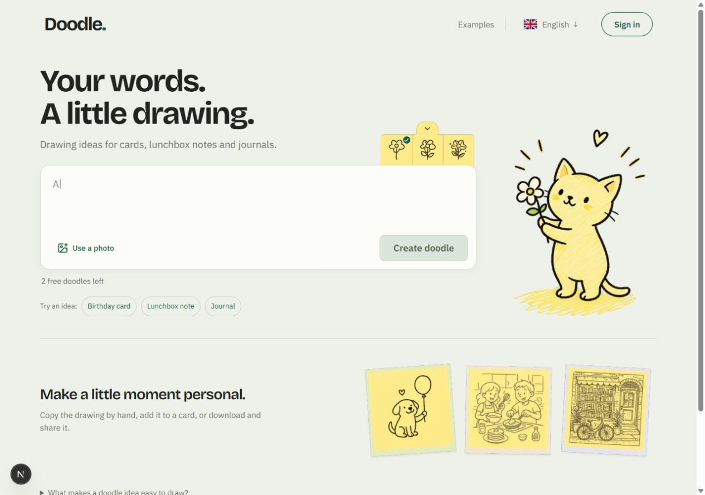
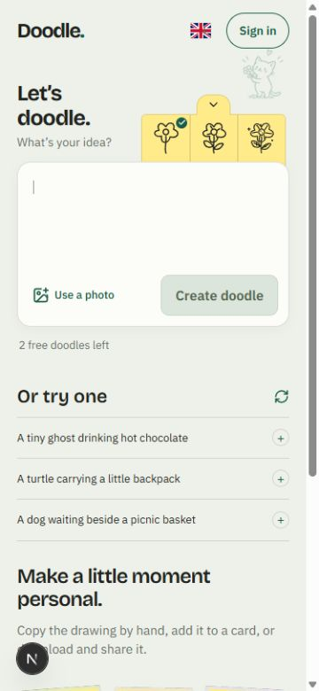
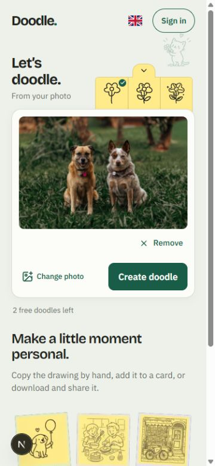
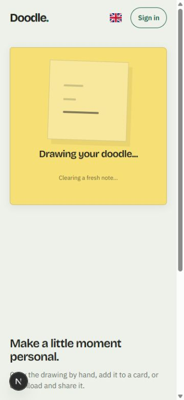
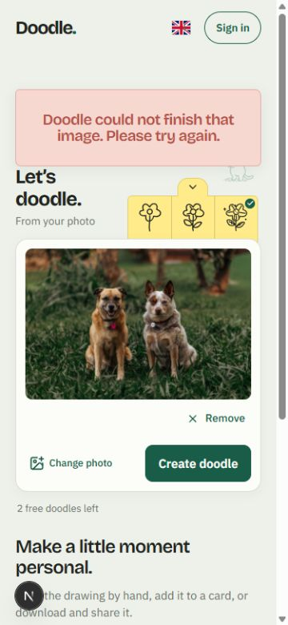
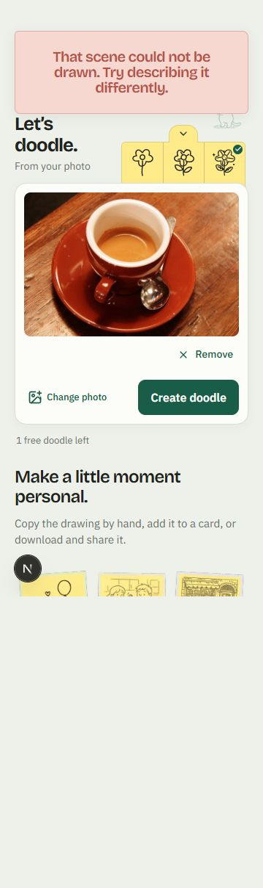
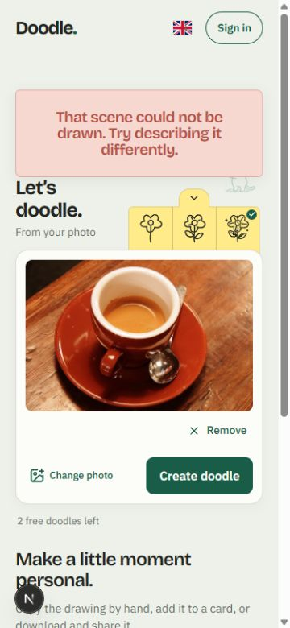
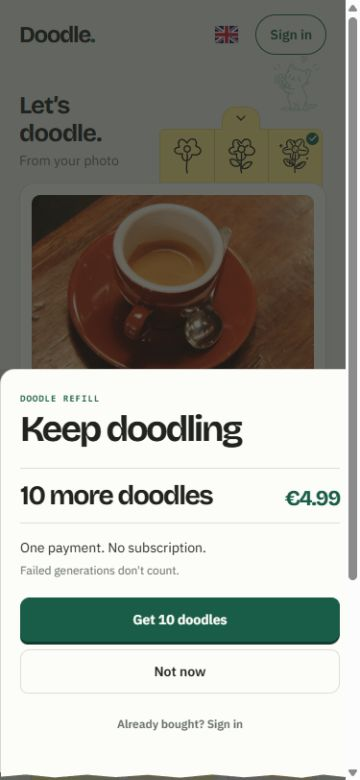
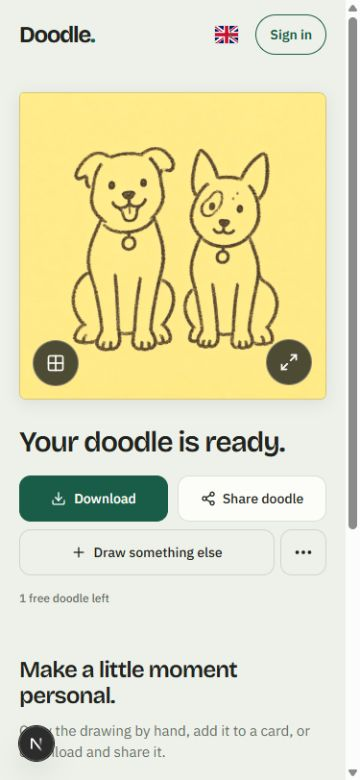

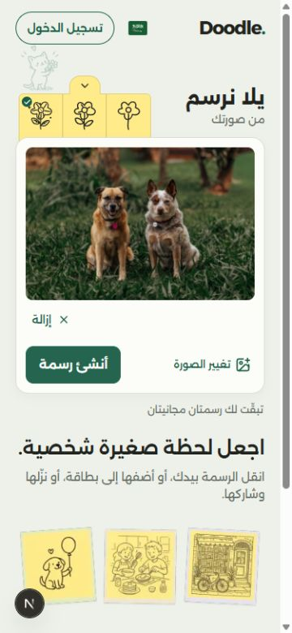
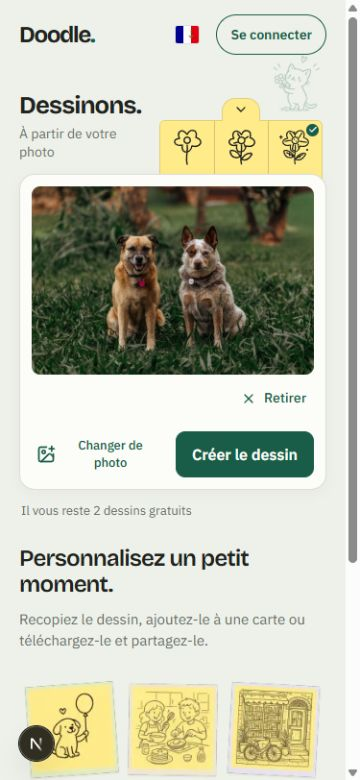
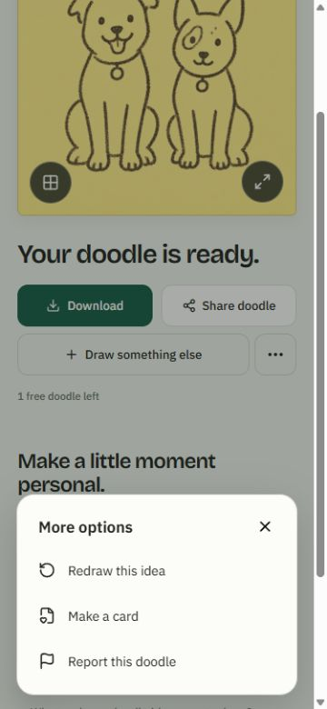
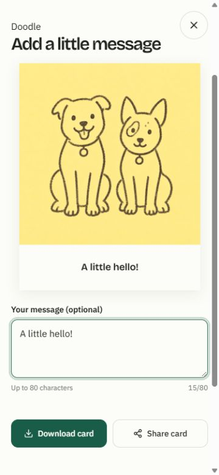
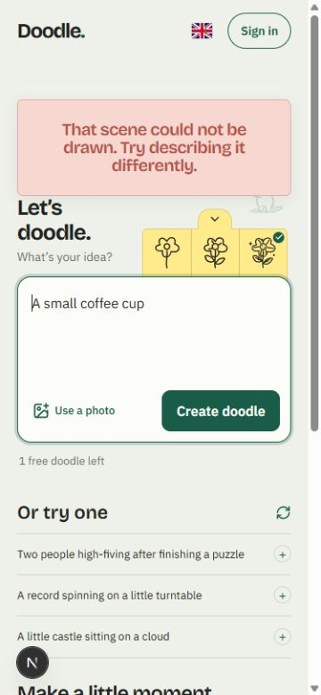
